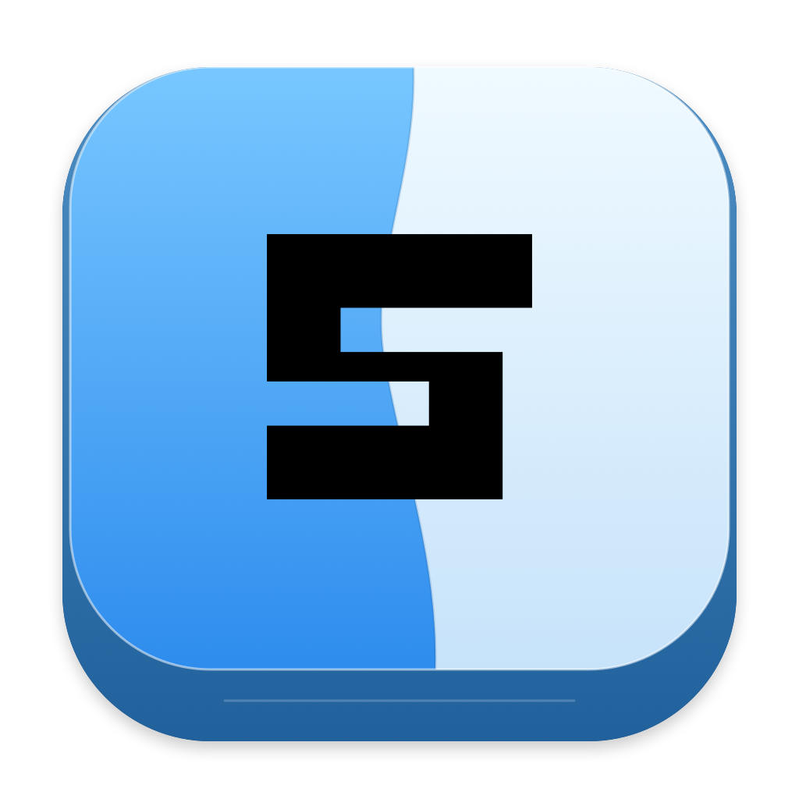

<p align="center">
  
</p>

<h1 align="center">strickey</h1>

## About

strickey is a lightweight Swift macOS menu bar app that adds the satisfying sound of a mechanical keyboard to everyday typing. It uses recorded Cherry MX switches, runs quietly in the background, and keeps your preferences on your Mac.

Requires **macOS 14 or later**. Native Liquid Glass is available on macOS 26+.

## Features

- **Cherry MX Red, Brown, and Blue** recordings with PBT keycaps, sourced from [Mechvibes](https://github.com/hainguyents13/mechvibes).
- Four regular-key variations per switch, plus dedicated space, return, and backspace recordings.
- An independent **0–100% keyboard volume** slider that follows your Mac's default output and system volume.
- Pause/resume, sound preview, and optional Command/Control shortcut filtering.
- Launch at login and background operation without a Dock icon.
- Compact, rounded Liquid Glass controls with neutral colors and support for Reduce Transparency.
- Local preferences; no typed text or keystroke history is recorded or sent over the network.

The strickey source code is licensed under [MIT](LICENSE). Bundled Mechvibes recordings retain their separate license and attribution in [their credits](Sources/StrickeyCore/Resources/CherryMX/CREDITS.md).

The website's fonts retain their respective SIL Open Font notices: [Geist Pixel](apps/web/src/app/fonts/OFL.txt) and [Manrope](apps/web/src/app/fonts/OFL-Manrope.txt).

## Local Setup

Install **Xcode 26+**, or Apple's Command Line Tools with **Swift 6+ and a macOS 26+ SDK**. The recordings are bundled, so building needs no Python audio libraries, ffmpeg, or third-party Swift packages.

```sh
git clone https://github.com/madvillax/strickey.git
cd strickey
./scripts/test.sh
./scripts/build-app.sh
open dist/Strickey.app
```

To install the latest published release from Terminal, download and run the shell installer:

```sh
curl -fsSL https://raw.githubusercontent.com/madvillax/strickey/main/scripts/install.sh -o /tmp/strickey-install.sh
zsh /tmp/strickey-install.sh
```

It installs to `~/Applications` and verifies the release checksum. You can also open the release DMG and drag `Strickey.app` into Applications.

To build and install the latest source directly, without downloading a release DMG, use the Python installer. This requires the same Xcode and Swift tools listed in Local Setup, plus Python 3.9 or newer and Git:

```sh
curl -fsSL https://raw.githubusercontent.com/madvillax/strickey/main/scripts/install-from-source.py -o /tmp/strickey-install-from-source.py
python3 /tmp/strickey-install-from-source.py
```

It builds the current `main` branch for your Mac and installs it to `~/Applications`. Set `STRICKEY_INSTALL_DIRECTORY` to choose another destination, or pass `--ref` to build a branch or tag. Homebrew does not run Python installers as `brew install`; its formulae and casks are Ruby-based.

Enable strickey in **System Settings → Privacy & Security → Input Monitoring**, then quit and reopen it. Click the keyboard icon in the menu bar to select a switch, adjust volume, or preview sounds.

If a rebuilt app still reports blocked keyboard access, turn its Input Monitoring entry off and on, then reopen. If necessary, remove the old entry and add the current `dist/Strickey.app`. Local builds use ad-hoc signing, so macOS may need access refreshed after a rebuild. Secure Input temporarily pauses typing sounds; preview works without keyboard access.

For a development window, quit the running app and use:

```sh
open dist/Strickey.app --args --preview-window
```

See [architecture.md](architecture.md) for implementation details, [CONTRIBUTING.md](CONTRIBUTING.md) for contributor guidance, and [the release guide](docs/RELEASING.md) for universal builds, DMG packaging, signing, and GitHub releases.

The Next.js landing page lives in [apps/web](apps/web). From the repository root, use Node.js 22+:

~~~sh
npm install
npm run dev
~~~

Open [localhost:3000](http://localhost:3000). The website includes an animated pixel keyboard, real switch-sound demos, an interactive app preview, and a permanent dark theme. See [the website guide](apps/web/README.md) for build and deployment details.
