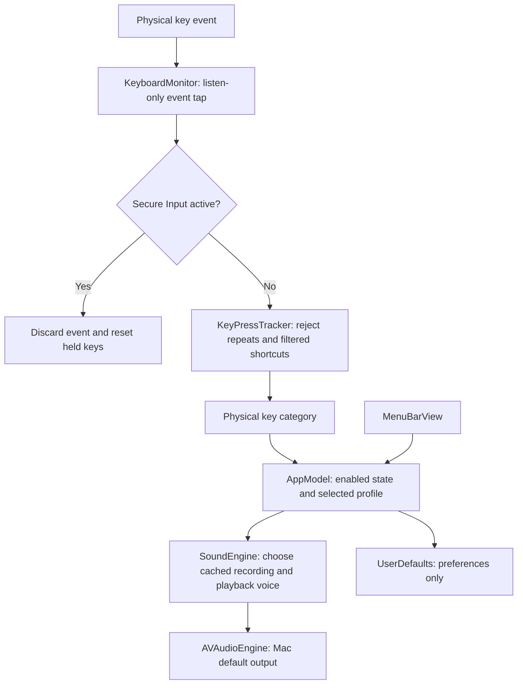

# strickey architecture

strickey is a native Swift application that listens for physical keyboard events and plays cached recordings through the Mac's default audio output. AppKit owns the application lifecycle and menu bar; SwiftUI presents the controls. There is no web view, backend service, or third-party Swift package dependency.

For development commands, see [Local Setup](README.md#local-setup). Distribution and release instructions are in [RELEASING.md](docs/RELEASING.md).

## Process and package structure

The executable runs in the logged-in user's graphical session as an `LSUIElement` app. It has a menu bar item and no Dock icon during normal operation. `SMAppService.mainApp` provides launch at login. It does not install a root LaunchDaemon or a separate helper process.

[Package.swift](Package.swift) declares macOS 14 as the minimum runtime. Building requires Swift 6 and an SDK that exposes the macOS 26 Liquid Glass APIs. Those APIs are guarded by availability checks; older systems use an `NSVisualEffectView` backdrop.

| Component | Responsibility |
| --- | --- |
| [StrickeyApp](Sources/Strickey/StrickeyApp.swift) | Starts AppKit, selects normal/development activation policy, and provides the muted audio smoke test. |
| [AppDelegate](Sources/Strickey/AppDelegate.swift) | Owns the status item, borderless controls panel, development window, lifecycle notifications, and shutdown cleanup. |
| [MenuBarView](Sources/Strickey/MenuBarView.swift) | Displays profiles, volume, preview, status, and settings through bindings to the model. |
| [AppModel](Sources/Strickey/AppModel.swift) | Coordinates permission/listening state, preferences, preview playback, login registration, and errors. |
| [KeyboardMonitor](Sources/Strickey/KeyboardMonitor.swift) | Creates and manages a listen-only global event tap and checks Secure Input. |
| [KeyPressTracker](Sources/StrickeyCore/KeyPressTracker.swift) | Pairs physical key-down/up events and rejects repeats, shortcuts, and unmatched releases. |
| [SwitchProfile / KeyKind](Sources/StrickeyCore/SwitchProfile.swift) | Defines switch metadata and the regular/space/enter/delete key categories. |
| [SoundLibrary](Sources/StrickeyCore/SoundLibrary.swift) | Finds bundled Cherry MX WAV files and validates/decodes their PCM data. |
| [SoundEngine](Sources/Strickey/SoundEngine.swift) | Preloads audio buffers, manages a fixed pool of playback voices, and applies app volume. |
| [SystemAudioOutput](Sources/Strickey/SystemAudioOutput.swift) | Reads the current default output device's name through Core Audio. |

`StrickeyCore` contains the key-tracking logic, profile definitions, WAV decoder, and recording resources. The executable target contains the macOS integrations. `StrickeyCoreTests` exercises the core without requesting global keyboard access.

## Typing data flow

1. `KeyboardMonitor` attaches a `.cgSessionEventTap` at `.headInsertEventTap` using `.listenOnly`, subscribing to key-down and key-up events.
2. The callback extracts only the physical key code, autorepeat flag, and Command/Control flags. It returns the original event unchanged.
3. Before delivering events, the monitor checks Secure Input. When it is active, held-key state is cleared and the event is ignored.
4. `KeyPressTracker` keeps a set of currently held key codes. An accepted key-down is mapped to a `KeyKind`; repeats, duplicate downs, and optionally Command/Control shortcuts produce no playback.
5. `AppModel` handles accepted key-downs only. It passes the current profile and key category to `SoundEngine`. A successful playback request sets the transient `typingDetected` indicator.
6. The engine cycles through recorded variants and playback voices, schedules an existing PCM buffer, and starts the selected voice.

Key-up events remove their key code from the held set. They do **not** play another clip: each recording already contains a complete press/release. Recorded release timing therefore comes from the clip, rather than following how long the user physically holds a key.

macOS key code 49 maps to space, 36/76 to return, and 51/117 to delete. Other codes map to regular keys; the app does not obtain the character they represent.

## Recordings and resource loading

The app contains **21 WAV recordings**: seven clips for each of Cherry MX Red, Brown, and Blue with PBT keycaps. Each switch has four regular-key clips and one clip each for space, return, and backspace.

The recordings originate from a pinned [Mechvibes](https://github.com/hainguyents13/mechvibes) revision. The upstream MIT license, [credits](Sources/StrickeyCore/Resources/CherryMX/CREDITS.md), and a [manifest](Sources/StrickeyCore/Resources/CherryMX/manifest.json) are included with the sound resources.

[scripts/import-cherry-mx.py](scripts/import-cherry-mx.py) is a development tool that:

1. Downloads the pinned upstream configuration and audio blobs.
2. Verifies the source audio's Git blob hash.
3. Uses each pack's configured time range to extract A/S/D/F, space, return, and backspace recordings.
4. Downmixes to mono, resamples to 44.1 kHz, linearly normalizes individual peaks to 90%, and adds 1 ms edge fades.
5. Writes 16-bit PCM WAV files and records output SHA-256 hashes in the manifest.

No synthesized sounds, pitch changes, or saturation are added. Re-importing needs Python 3 plus Ogg-capable `afconvert` or ffmpeg; ordinary builds and installed apps use the checked-in WAV files.

SwiftPM packages `Resources/CherryMX` into `Strickey_StrickeyCore.bundle`. The app build script copies that bundle into `Strickey.app/Contents/Resources`. `SoundLibrary` explicitly uses this packaged bundle when running inside an `.app`; package tests and unbundled development binaries use `Bundle.module`. This prevents a distributed app from relying on the developer's `.build` directory.

The WAV decoder accepts mono, 44.1 kHz, 16-bit PCM RIFF/WAVE files. It rejects damaged headers, truncated chunks, unsupported formats, empty audio, and invalid variant indices. Missing or damaged assets become an audio error; the engine does not silently substitute synthesized effects.

## Playback, volume, and concurrency

`SoundEngine` prepares **48 cached PCM buffers**: three profiles × four key categories × four variant slots. The special-key slots reuse their category's recording, while regular-key slots hold four distinct recordings. All file loading and decoding happens during engine initialization.

A fixed pool of **24 `AVAudioPlayerNode` voices** permits overlapping keystrokes while bounding memory and scheduling work. Each playback advances the variant counter and voice counter. Reusing a voice stops its previous sound before scheduling the next buffer. Typing does not create player nodes or decode files.

App coordination and playback scheduling run on the main actor. The event tap is attached to the main run loop in common modes. The callback extracts value types before crossing the actor boundary, so a `CGEvent` is not passed between actors. AVAudioEngine performs audio rendering separately.

The volume slider changes `mainMixerNode.outputVolume` from 0 to 1. macOS applies system volume downstream, and AVAudioEngine follows the default output device. The app does not change system volume or force a hardware device. Normalization bounds individual recording peaks; it is not a limiter for the sum of overlapping voices.

On an audio configuration change, the engine stops its voices and graph. The next playback prepares and starts it again. Core Audio device-name polling updates the output label independently of playback.

## Listening state and lifecycle

`AppModel.refresh()` runs every two seconds, with a 0.5-second timer tolerance, and also runs when controls appear or settings change. It checks Input Monitoring, login registration, Secure Input, and the output name.

| State | Trigger and behavior |
| --- | --- |
| `sleeping` | Sleep notification: listener and audio stop, preview is cancelled. |
| `paused` | Sounds disabled: listener stops; preview can still run. |
| `needsPermission` | Input Monitoring preflight fails: listener stops and permission controls appear. |
| `secureInput` | Secure Input is active: listener stops until refresh detects that it has ended. |
| `listening` | Permission is granted and the event tap starts successfully. |
| `unavailable` | Permission is granted but starting the event tap fails. |

Stopping the monitor disables/invalidates its tap, removes its run-loop source, and clears held keys. The callback also handles a disabled tap by resetting held keys and re-enabling it when permission remains available. Wake refreshes listening state. Quit cancels preview, invalidates the timer, shuts down audio, removes observers, and removes the status item.

Preview is a cancellable task that schedules five recorded strokes 250 ms apart. It works while typing is paused or permission is missing. Preview does not set `typingDetected`, so that indicator remains tied to accepted physical key-down events.

## Controls and persisted preferences

Manual launches, Finder reopens, and the menu bar button reveal a clear, borderless `NSPanel`. Login launches (or `--background`) stay quiet. Presentation waits briefly for activation and status-item placement, preserves reopen requests during startup, and falls back to a centered panel when the menu bar has no anchor. Duplicate launches send a real reopen request to the older instance and exit without creating another audio graph or listener. The panel moves to the active Space and stays constrained to the screen. SwiftUI draws a slightly darkened regular Liquid Glass surface on macOS 26+, with neutral profile and switch controls. The panel uses dark appearance for consistent contrast; its header uses the Finder-inspired blue/ice keycap app icon. The host does not add another opaque popover backdrop. Reduce Transparency uses an opaque system background.

`AppModel` persists enabled state, profile, keyboard volume, and shortcut filtering through `UserDefaults`. Existing `linear`, `tactile`, and `clicky` preference values map to MX Red, Brown, and Blue. The old full-system-volume setting migrates to full app gain; normal system volume still applies afterward.

Launch at login is registered/unregistered through `SMAppService.mainApp`. Its status is read from macOS; the panel can direct the user to approve it in Login Items when required.

## Permissions and privacy

Global keyboard listening requires **Input Monitoring**, checked with `CGPreflightListenEventAccess` and requested with `CGRequestListenEventAccess`. The app does not require Accessibility, Full Disk Access, or microphone permission for its typing/audio flow.

Ad-hoc signatures change the executable's code identity on rebuilds, so an existing Input Monitoring entry may need to be refreshed for the current app. Permission should belong to the exact installed app copy. Stable Developer ID signing is the distribution path described in [the release guide](docs/RELEASING.md).

The application never requests Unicode characters, classifies typed text, suppresses keys, stores a keystroke history, or sends events over the network. Held key codes and `typingDetected` are transient process state. Secure Input is handled through the macOS API, without inspecting password fields.

## Monorepo and landing page

The native Swift package remains at the repository root. apps/web is a separate Next.js App Router workspace using React, TypeScript, Tailwind CSS v4, locally served Geist Pixel Square, and native CSS animation. Root npm scripts delegate to the website workspace; the native build and release scripts keep their existing paths.

scripts/sync-web-assets.mjs copies the existing logo and Cherry MX recordings, manifest, credits, and license into the website's ignored public/generated directory before development and production builds. The website does not maintain a second copy of these source assets.

The main page is a Server Component. Interactive client islands handle the pixel keyboard canvas, audio playback, app controls, and section reveals. The keyboard draws pressed keys directly on canvas; React does not render on each animation frame. Animation pauses when the canvas is offscreen or the document is hidden, and automatic typing stops for reduced motion or user input.

useKeyboardAudio creates its Web Audio context only after an explicit visitor action. It caches recordings, decodes samples, and mixes one-shot playback at the selected volume. Browser typing is handled only in the demo input. The website never requests global keyboard access, persists typed text, or sends it to a service. The site stores no appearance preference.

The homepage is statically rendered in permanent dark mode, ignoring any previously stored theme choice. Download buttons point directly at the universal DMG committed in apps/web/public/downloads. Its filename, version, size, and SHA-256 are recorded in release.json, and a pre-build check rejects missing or mismatched package files. Next.js serves the DMG as an attachment; the legacy /download route aliases that same local file. GitHub is not contacted during downloads.

scripts/build-web-package.sh builds and verifies the native release in an isolated temporary tree, preserving the running local app and its keyboard permission. scripts/prepare-web-download.mjs verifies the release checksum and stages the DMG, sidecar, and metadata for the website. The release workflow also produces a strickey-website-download artifact for committing future website packages. Website builds on Linux serve the committed DMG and do not require Swift or macOS.

The separate .github/workflows/web.yml runs npm installation, ESLint, TypeScript checks, and a production build on Linux for website/shared-asset changes. Node dependencies are development tooling for the site and are not bundled into the macOS app.

## Testing and CI

[Tests/StrickeyCoreTests](Tests/StrickeyCoreTests/StrickeyCoreTests.swift) covers loading all profile/category/variant combinations, bounded finite PCM and edge fades, distinct recordings, malformed assets, key mapping, repeat filtering, shortcut filtering, and release pairing/reset.

[scripts/test.sh](scripts/test.sh) runs Swift Testing with XCTest disabled. It explicitly loads the Testing macro plugin when the installed Command Line Tools require that discovery workaround.

[Tests](.github/workflows/tests.yml) runs on branch pushes, pull requests, and manual dispatch. Its macOS 26 matrix uses Apple Silicon and Intel runners. Each job checks script syntax, runs the core tests, builds/signature-verifies a native `.app`, checks its architecture, and verifies that all 21 packaged recordings and their attribution match the manifest. Jobs use read-only repository permissions, and newer runs cancel obsolete runs for the same branch/PR.

CI does not request Input Monitoring or require an audio device. Physical typing, perceived sound/latency, default-output changes, Secure Input, and launch-at-login behavior still require manual macOS verification. The build script stages and signs the new app first, stops only a running executable at the project’s exact `dist/Strickey.app` path, and then replaces that bundle. If it cannot stop the old process, replacement fails and the installed bundle is preserved. This avoids modifying a running signed executable.

The separate [release workflow](.github/workflows/build-release.yml) builds universal DMG artifacts on manual dispatch; [RELEASING.md](docs/RELEASING.md) documents that path.

For local hardware checks, the packaged executable's `--smoke-test` starts the real engine muted and schedules a recording. [scripts/verify-release.sh](scripts/verify-release.sh) verifies a DMG's checksum, mounts it read-only, checks architectures and signatures, and runs that smoke test from the mounted app to verify bundled resource loading outside the build tree.
